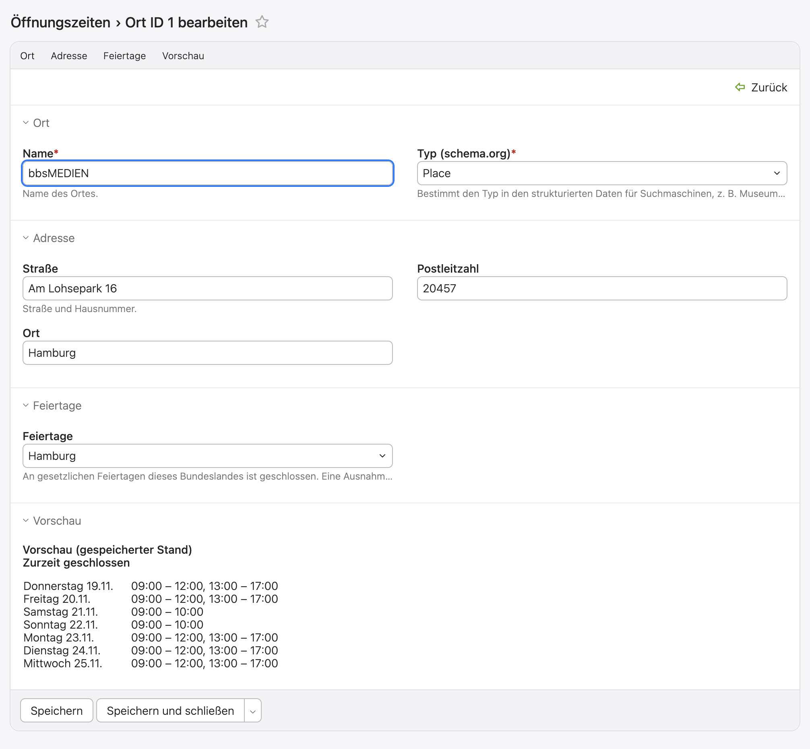
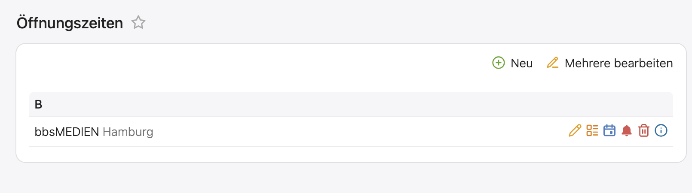
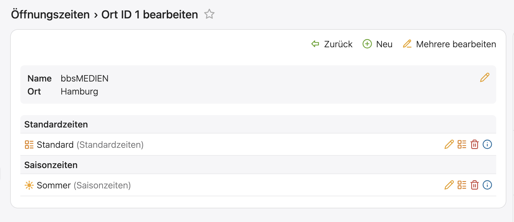
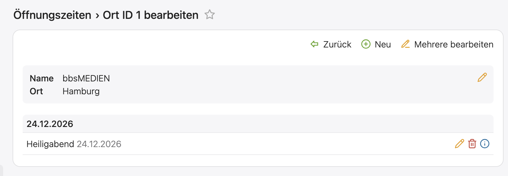
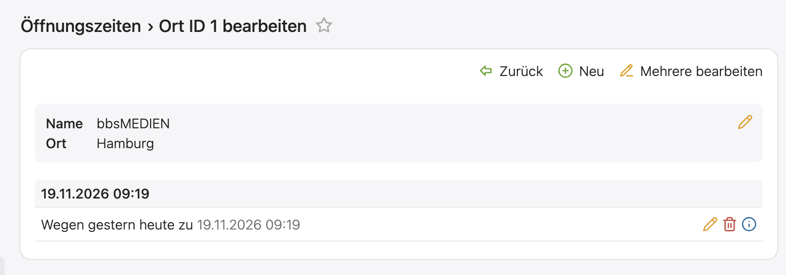
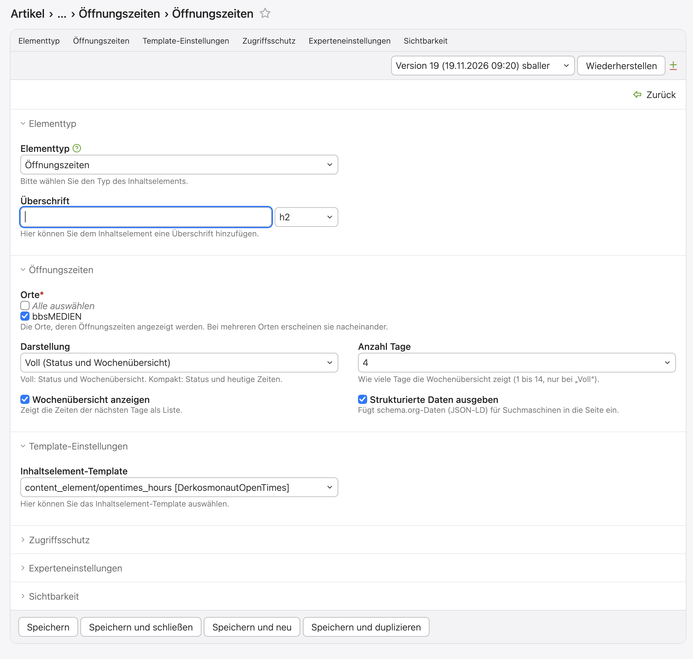
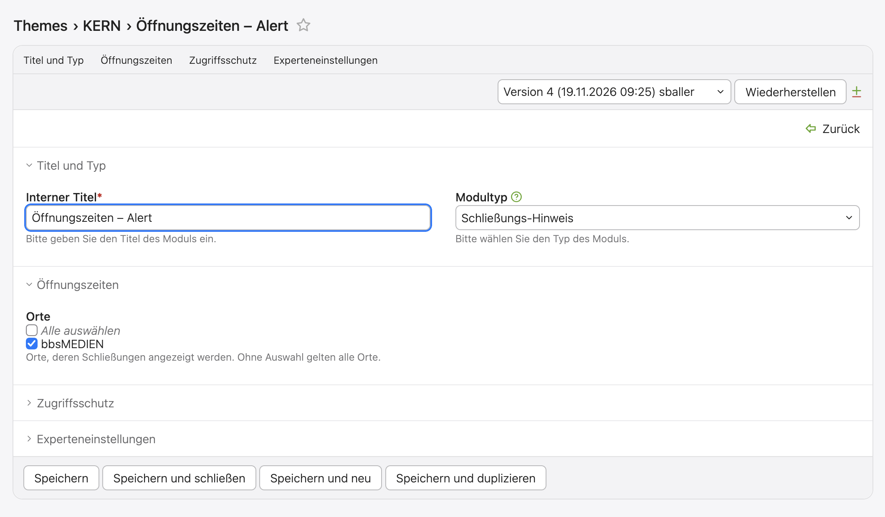
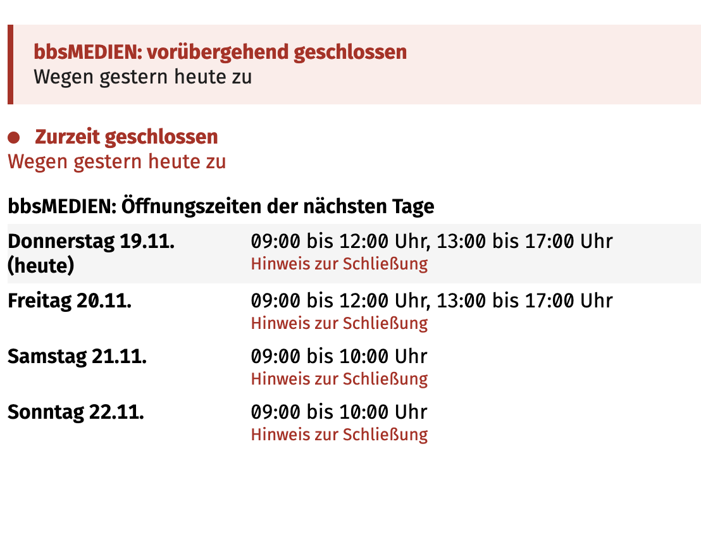

<p align="center"></p>

# opentimes_contao

*** Release Candidate: im Einsatz getestet, aber noch nicht als stabil gekennzeichnet ***

Eine kleine Öffnungszeiten-Erweiterung für Contao (Bundle für Contao 5.7 oder neuer, PHP 8.5).

## Funktionsumfang (Ziel)

- Mehrere Orte
- Standardöffnungszeiten (Wochenraster, mehrere Zeitfenster pro Tag)
- Saisonzeiten (Zeitraum, jährlich wiederholbar, Priorität)
- Ausnahmen (z. B. Feiertage: geschlossen oder abweichende Zeiten)
- Spontane Schließung mit Hinweistext
- Nachtbetrieb (Fenster über Mitternacht)
- Gesetzliche Feiertage je Bundesland (geschlossen, eine Ausnahme hat Vorrang)
- Zwei Zeitfenster pro Eintrag, Vorschau und Hinweise im Backend
- Content-Element und Frontend-Modul, Layouts „Voll“, „Kompakt“ und „Übersicht“, jeweils mit einem oder mehreren Orten
- Deutsche und englische Texte

## Auflösungsreihenfolge

Die speziellere Ebene schlägt die allgemeinere:

1. Spontane Schließung
2. Ausnahme
3. Feiertag (geschlossen, aber schwächer als eine Ausnahme)
4. Saison
5. Standardzeiten

## Stand

Funktionsumfang vollständig umgesetzt und im Contao-Backend und -Frontend geprüft. Der Resolver
(`src/Resolver/`, reines PHP) und die Datenbank-Anbindung sind mit Tests abgedeckt.

## Anwendung

**1. Ort anlegen.** Unter „Inhalte → Öffnungszeiten“ einen Ort mit Name, Typ (schema.org) und Adresse anlegen. Optional
lässt sich ein Bundesland für die gesetzlichen Feiertage wählen. Die Vorschau am Ende der Maske zeigt den
gespeicherten Status und die nächsten Tage.



In der Ortsliste führen die Symbole rechts zu den Zeitplänen, Ausnahmen und Schließungen des Ortes.



**2. Zeitpläne.** „Standardzeiten“ gelten immer, „Saisonzeiten“ nur im angegebenen Zeitraum (optional jährlich
wiederholt, bei Überschneidung gewinnt die höhere Priorität). Je Zeitplan legst du Zeitfenster an: Wochentage
anhaken (mit Schnellauswahl) und bis zu zwei Fenster pro Eintrag, z. B. 09:00–12:00 und 13:00–17:00.



**3. Ausnahmen.** Für einzelne Tage oder Zeiträume (z. B. Heiligabend): geschlossen oder mit abweichenden Zeiten.
Eine Ausnahme ersetzt den ganzen Tag und schlägt Zeitpläne und Feiertage. Bei einem einzelnen Tag das Ende leer lassen.



**4. Spontane Schließung.** Unter „Schließungen“ Hinweistext und Beginn eintragen, das Ende ist optional („bis auf
Weiteres“). Sie hat die höchste Priorität. Mit dem Haken „Als Alert ausspielen“ erscheint sie zusätzlich im
Schließungs-Hinweis (Schritt 6). Zum Beenden Ende setzen, „Aktiv“ abwählen oder löschen.



**5. Ausgabe auf der Seite.** Das Inhaltselement „Öffnungszeiten“ in einen Artikel einfügen (oder das gleichnamige
Frontend-Modul im Seiten-Layout). Orte anhaken, Darstellung („Voll“ oder „Kompakt“) und Anzahl der Tage wählen,
Wochenübersicht und strukturierte Daten (schema.org) ein- oder ausschalten.

Die Darstellung „Übersicht“ fasst alle Zeiten eines Ortes zusammen, praktisch für die Planung im Voraus: **Standard**
(Wochentage mit gleichen Zeiten gebündelt, z. B. „Mo–Fr“), **Saison** (jede Saison mit Zeitraum, die aktuelle ist
markiert) und **Ausnahmen und Feiertage** der nächsten Monate. Wie weit voraus, bestimmt der „Vorschau-Zeitraum“
(1 bis 24 Monate). Damit die Ausnahmen mit Namen erscheinen, bekommen sie beim Anlegen einen Titel
(z. B. „Betriebsferien“). Feiertage stammen aus dem beim Ort gewählten Bundesland.



**6. Schließungs-Hinweis im Seiten-Layout.** Das Modul „Schließungs-Hinweis“ anlegen (Orte wählen, ohne Auswahl
gelten alle) und im Seiten-Layout einbinden. Es bleibt leer, bis eine Schließung mit dem Haken „Als Alert
ausspielen“ läuft, und blendet sich zu Beginn und Ende automatisch ein und aus.



So sieht das Ergebnis aus: oben der Hinweis des Moduls, darunter Status und Wochenübersicht des Inhaltselements.



## Ausgabe

Im Backend unter „Inhalte → Öffnungszeiten“ Orte, Zeitpläne, Ausnahmen und
Schließungen pflegen. Beim Ort zeigt eine Vorschau Status und die nächsten sieben Tage und
weist auf Unstimmigkeiten hin (z. B. überlappende Saisons mit gleicher Priorität). Bei den
Wochentagen eines Zeitfensters gibt es eine Schnellauswahl („Mo–Fr“, „Wochenende“, „Alle Tage“).

Auf der Seite das Inhaltselement oder das Frontend-Modul „Öffnungszeiten“ einfügen. Die Darstellung:

- **Voll:** Status, optional Wochenübersicht (1 bis 14 Tage)
- **Kompakt:** Status und die Zeiten von heute, z. B. für Kopf- oder Fußbereich

Es lassen sich ein oder mehrere Orte anhaken; bei mehreren erscheinen sie nacheinander mit ihrem Namen.

Optional gibt es strukturierte Daten nach schema.org (JSON-LD, `openingHoursSpecification`):
reguläre Wochenzeiten plus abweichende Tage der nächsten 30 Tage
(Ausnahmen, Feiertage, Saisonwechsel, Schließungen).

Die Templates liegen in `contao/templates/` und lassen sich im Theme überschreiben:
`content_element/opentimes_hours.html.twig`, `frontend_module/opentimes_hours.html.twig` sowie die Bausteine
`opentimes/_output`, `_status`, `_week`, `_compact` und `_json_ld`.

Die Wochenübersicht ist eine Beschreibungsliste (`dl`) mit ausgeschriebenem „von … bis …“,
damit sie für Screenreader gut lesbar ist. Der Status trägt die Klasse
`opentimes__status--open`, `--closed` oder `--unknown`. Ein kleines Stylesheet
(`public/css/opentimes.css`) färbt geöffnet grün und geschlossen rot; die Farben lassen sich im
Theme über die CSS-Variablen `--opentimes-open`, `--opentimes-closed` und `--opentimes-unknown` anpassen.

### Schließungs-Hinweis (Alert)

Das Frontend-Modul „Schließungs-Hinweis“ lässt sich im Seiten-Layout einbinden. Solange keine
Schließung läuft, gibt es nichts aus. Beginnt eine aktive Schließung mit dem Haken „Als Alert ausspielen“ (Beginn erreicht, Ende noch
nicht), erscheint ein Hinweis mit Ortsname, Text und, falls gesetzt, dem voraussichtlichen Ende;
nach dem Ende verschwindet er wieder. Schließungen ohne den Haken erscheinen nur in der
Öffnungszeiten-Ausgabe (Status „geschlossen“ mit Hinweistext), nicht als Alert. Ohne Orte-Auswahl gelten alle Orte. Der Hinweis lässt sich über
`.opentimes-alert` gestalten und über das Template `frontend_module/opentimes_alert` überschreiben.

Die Antwort wird bis zum nächsten Beginn oder Ende einer Schließung gecacht (15 Sekunden bis 5 Minuten).
Hinweis: Ein Modul im Seiten-Layout verkürzt damit auch die Cache-Zeit der ganzen Seite.

### Cache

Die Antwort wird bis zur nächsten Statusänderung gecacht, mindestens 60 Sekunden und höchstens
5 Minuten. Zusätzlich trägt sie Cache-Tags der Tabellen, damit Änderungen im Backend die Seite
bei einem Tag-fähigen Cache gleich ungültig machen.

### Feiertage

Beim Ort lässt sich ein Bundesland wählen. Dessen gesetzliche Feiertage gelten als geschlossen,
sofern keine eigene Ausnahme für denselben Tag besteht. Regional unterschiedliche Feiertage
(z. B. Mariä Himmelfahrt in Bayern) sind nicht enthalten und lassen sich als Ausnahme anlegen.

## Tests

```
composer install
vendor/bin/phpunit
```

Die Tests laufen bei jedem Push auch in GitHub Actions, dazu eine statische Analyse (PHPStan).
Beim Veröffentlichen eines Releases laufen die Tests erneut; Packagist wird bei hinterlegten Zugangsdaten sofort benachrichtigt.


## Lizenz

GPL-3.0-or-later, siehe `LICENSE`.
